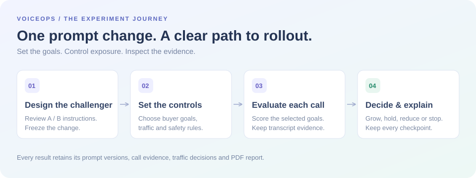
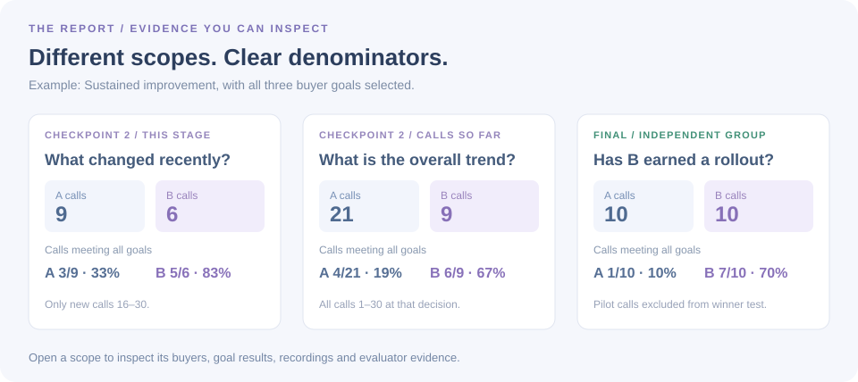

# VoiceOps — Better buyer conversations, measured

VoiceOps gives your buyer experience team a workspace to improve voice agent prompts, test a change on a small share of calls, and expand it when the evidence supports it. Every traffic decision comes with the calls, goal results and reasoning that led to it.

## Built with Sarvam

> **VoiceOps listens, speaks and thinks with Sarvam.** Every voice in the buyer cohort, every word the live agent hears, every reply it writes and every new call verdict runs on Sarvam's Indian-language AI stack. It is built for the way IndiaMART buyers actually talk: Indian English, Hindi and Hinglish.

| What VoiceOps does | Powered by | Where you'll see it |
|---|---|---|
| Speaks to buyers in natural Indian voices | **Sarvam Bulbul v3** (text-to-speech) | All 135 prepared call recordings, with six buyer voices and two caller voices, plus the spoken replies in **Try the agent** |
| Understands what the buyer says | **Sarvam Saaras v3** (speech-to-text) | Microphone input in **Try the agent**, in English and Hindi/Hinglish |
| Writes challenger prompts, holds the conversation and judges each call | **Sarvam-105B** (chat model) | **Generate variant B**, the live agent's replies and field capture, and the call evaluator |

The rest of the stack keeps the workspace fast and the evidence safe:

| Layer | Tools |
|---|---|
| Workspace | React 19, TypeScript, Vite |
| Hosting and API | Cloudflare Workers; provider keys stay on the server |
| Reports and history | Supabase (Postgres with row-level security) |
| Verification | Node test runner, Playwright browser checks, PDF layout checks |

## Coming next: going deeper with Sarvam

VoiceOps already decides *which* prompt deserves more traffic. These enhancements would put Sarvam's agent platform under that decision as well:

| Enhancement | Sarvam product | What it adds |
|---|---|---|
| Variants as real voice agents | **Sarvam Voice Agents (Samvaad)** | A and B become two versioned Samvaad agents. Agent variables carry the buyer's name, city and product in, and bring quantity and specifications back. |
| Live outbound calls | **Samvaad outbound calling and webhooks** | VoiceOps assigns each buyer to A or B, Sarvam places the call, and the transcript returns to VoiceOps for scoring at the next checkpoint. |
| Preview the exact agent under test | **Sarvam web widget and Web SDK** | **Try the agent** talks to the same Samvaad agent that receives real traffic. |
| New variant types | **Bulbul voices and Sarvam-105B** | Compare a voice, speaking pace or opening line, not only the prompt text. |
| Every Indian language | **Samvaad's 10 Indian languages plus English** | Run the same experiment per language and compare results side by side. |
| Follow up where buyers already are | **Samvaad on WhatsApp** (enterprise channel) | Continue an unfinished requirement over WhatsApp voice or chat. |
| Catalogue-aware answers | **Samvaad knowledge base** | The agent explains unfamiliar specifications from the product catalogue, without promising price or stock. |
| A morning rollout brief | **Sarvam Indus Cowork** | A scheduled Cowork agent reads the latest reports and sends the team the current leader, traffic changes and calls worth hearing, by email or Slack. |

For IndiaMART, the journey begins when a buyer searches for a product but leaves before posting a requirement. The agent follows up, confirms the need, and collects the quantity and product specifications. VoiceOps helps you answer a practical question: **does a new conversation approach collect better requirements?**



## Your first five minutes

You can explore a complete result before creating a test. Open [Sample outputs](#/samples), choose **Sustained improvement**, and click anywhere on the card. Scroll through **Traffic allocation**, inspect a checkpoint's calls, then open a buyer to hear the conversation and review its evidence. Finish with **Export PDF**.

When you are ready to try the workflow yourself, open [Start new A/B](#/start). The workspace guides you through three steps: **Prompt variants**, **Experiment setup**, and **Results & rollout**.

> Start with a sample report to see what a good decision looks like. Then create a challenger and choose the goals that matter to your team.

## 1. Describe the improvement

**Variant A** is your control: the prompt you are comparing against. **Variant B** is your challenger. You can edit the control, describe an improvement in plain language, or pick one or more suggested improvements, which combine into a single challenger you can preview immediately.

For example, choose **Explain unfamiliar specs** to help buyers answer product questions with less friction. For a custom request, describe the behavior you want and select **Generate Variant B**. The prompt writer turns your request into instructions you can inspect and edit.

The **Changes** view highlights added and removed instructions; **Full prompt** shows the complete challenger. Review the hypothesis and changes, then select **Next: set up experiment**. Prompts are frozen when the test starts, so its report always refers to the exact versions used.

## 2. Choose what success means

Select one or more buyer goals. Every selected goal appears separately in the call tables and A/B comparisons.

| Goal | A call meets it when… |
|---|---|
| Confirm requirement | The buyer confirms they still need the product. |
| Capture specifications | Both configured product specifications are collected. |
| Collect quantity | The buyer's required quantity is recorded. |

**All selected goals** measures calls that satisfy every goal you enabled. A buyer who confirms interest and gives a quantity can pass those two goals while still missing specifications. Unanswered calls remain part of the comparison and count as unsuccessful.

Next, configure the exposure you are comfortable with:

| Control | How you use it |
|---|---|
| Start B at | Give the challenger a small initial audience share, from 5% to 50%. |
| Increase B by | Choose the size of each positive traffic adjustment. |
| Maximum B share | Set the rollout ceiling if B earns a supported win. |
| Automatic / Review first | Apply eligible increases automatically, or retain them as recommendations. |
| Reduce B if results get worse | Lower exposure when the challenger falls behind. |
| Keep the quality of collected details | Prevent growth when B collects fewer requirement details. |
| Rollout confidence | Require Standard or Stronger evidence before declaring a winner. |

Select **Start experiment**. Goals and decision settings are frozen alongside the prompts. The workspace keeps the evaluation and policy consistent throughout the test.

## 3. Follow the test and its decisions

The activity panel shows the buyer, assigned variant, outcome, selected goals and call duration. You can pause and resume the test, or open any completed call to inspect it.

Below the activity panel, **Traffic allocation** connects the chart to a stage-by-stage account of what happened. Each stage shows:

1. **Incoming allocation** — the B traffic target entering that stage.
2. **This stage** — new A/B call counts, with goal percentages and successful calls divided by assigned calls.
3. **Calls so far** — cumulative A/B counts and goal results at that checkpoint.
4. **Decision** — whether B grows, holds, reduces or stops, with the reason and the next traffic target.



**A traffic target applies to future assignments.** It does not change the variant of calls that have already happened. That is why “B is now at 40%” and “B handled 9 of 30 calls so far” can both be correct.

For example, at checkpoint 2 in **Sustained improvement**, the latest stage adds **9 A calls and 6 B calls**. The cumulative totals become **21 A and 9 B**. This stage's complete-goal rates are **3/9 (33%) for A** and **5/6 (83%) for B**; the cumulative rates are **4/21 (19%)** and **6/9 (67%)**. Both views are displayed so you can distinguish a recent improvement from the overall trend.

## Inspect the evidence behind any result

Select a stage's **Inspect calls** control to see the exact buyers available at that decision. Switch between **This round**, **Calls so far**, and, where available, **Final comparison**. Filter by A or B to check how many calls each variant actually received.

Each call has a separate column for every selected goal, an overall pass result, a disposition and a duration. Open the call to review:

- The recording and full agent/buyer transcript.
- The requirement fields collected from the buyer.
- The evaluator's disposition and explanation.
- The buyer quotes supporting extracted fields.

The **Show activity** view follows every numbered call in its original order, grouped by round. It lets you walk from an individual buyer's response to the checkpoint decision without losing the sequence.

An LLM evaluates the conversation and tags its outcome. Goal scoring validates the collected fields against buyer evidence; the rollout policy uses those scores to decide what happens next. You can inspect the complete chain in the report.

## Explore six possible paths

[Sample outputs](#/samples) contains completed experiments you can open without rerunning a test. Each card previews its traffic path and A/B success rates. Click the card to open the full journey, or use its PDF button to download the report directly.

| Sample | What it demonstrates |
|---|---|
| Sustained improvement | B improves and earns a rollout to 100% under the default policy. |
| Early growth, safety stop | A promising challenger stops when an unsafe promise appears. |
| Early growth, then retreat | An early gain fades; exposure reduces and stays limited. |
| Slow start, then recovery | B improves later, while the final evidence remains inconclusive. |
| Close comparison | Neither variant earns promotion; exposure stays steady. |
| Control performs better | A wins the final comparison and B is stopped. |

The result is not always “roll out B.” A limited share, a reduction, an early stop or a recommendation to keep testing can all be the appropriate outcome. New sandbox tests cycle through these conditions; your selected goals and controls can change the resulting decisions.

## Take the result with you

**Results & recommendation** combines the selected-goal comparison, outcome distribution and next action. The winner is checked against an independent comparison group, so an encouraging adaptive pilot is not sufficient on its own to justify a full rollout.

**Export PDF** downloads a report containing the traffic path, stage and cumulative tables, checkpoint reasons, numbered call results, decision method and frozen prompts. Completed experiments are saved with their evidence and can be reopened through **Sample outputs**.

## Try the voice agent

Use **Try the agent** in the top bar to experience the requirement collector directly. Choose a product and variant, adjust the buyer context, and use text or microphone input. Sarvam powers the whole conversation: Saaras transcribes the buyer, Sarvam-105B writes each reply and captures the requirement, and Bulbul speaks it in an Indian voice. The agent supports English and Hindi/Hinglish.

The collector handles quantity, configured specifications, volunteered details, corrections and refusals. Explore the [Buyer cohort](#/cohort) to see product questions and different conversation challenges.

## About this workspace

This evaluation workspace simulates buyer calls using 50 personas across six product categories. It exercises the actual goal scoring, traffic policy, audit report and persistence flow. Sandbox runs use prepared conversations; use **Try the agent** to assess a custom prompt interactively. Measuring production uplift and applying traffic changes to real calls requires a live calling integration, such as the Sarvam Voice Agents path described in [Coming next](#coming-next-going-deeper-with-sarvam).

Read [skills.md](skills.md) for the product design decisions, evaluation method, architecture and tools used to build VoiceOps.

## Meet the team

**Team name: The Doom Squad**

| Participant | Employee ID |
|---|---|
| Prithvi Guha | 93421 |
| Ashutosh Singh | 101592 |
| Soumyajeet Sen | 93513 |

Open [Team details](#/team) in the workspace to meet the team behind VoiceOps.

## Run your own workspace

Use Node.js 22+, install the dashboard dependencies, and start the local frontend/API:

```powershell
cd dashboard
npm install
npm run dev
```

Open [localhost:3000](http://127.0.0.1:3000). Configure the workspace-root `.env` from [.env.example](.env.example), then run [schema.sql](dashboard/supabase/schema.sql) in the Supabase SQL Editor. Provider and database keys are used by the backend.

The [technical setup guide](dashboard/README.md) covers configuration, verification and sample artifact generation. The [sample artifact index](sample-outputs/README.md) links the six PDF reports and their full audit data.
