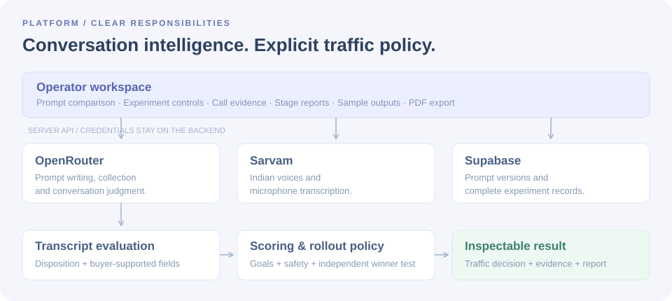

# VoiceOps — Product design & engineering

VoiceOps is designed around one operating principle: **a team should be able to understand and inspect a traffic decision before trusting it.** The platform brings prompt creation, experiment controls, conversation evaluation and rollout evidence into one continuous journey.

This document explains the design decisions behind the workspace, the capabilities used to implement them, and how the product was built and verified. For a guided experience, start with the [README](README.md).

## Built with Sarvam: where each model fits

VoiceOps runs its whole conversation loop on Sarvam. We chose Sarvam because IndiaMART buyers speak Indian English, Hindi and Hinglish, and Sarvam's models are built for exactly those voices and languages. One provider for listening, speaking and reasoning also keeps a single key, a single bill and one consistent behaviour across the product.

| Sarvam model | Job in VoiceOps | How it is wired |
|---|---|---|
| **Sarvam-105B** (chat) | Writes challenger prompts, judges every call, and drives the live collector | Called from the Cloudflare Worker at `/v1/chat/completions` with JSON output and reasoning switched off, so replies come back fast and direct. The prompt writer returns `{prompt, changes, hypothesis}`. The evaluator returns a disposition and an exact buyer quote for every field; the backend rejects any quote that the buyer never said. The live collector extracts fields, then asks exactly one question per turn. |
| **Sarvam Bulbul v3** (text-to-speech) | Gives the agent and the 50 buyers their voices | 135 prepared WAV recordings: six buyer voices (three male, three female) and two caller voices in Indian English, cached per speaker and line. Live replies can use six selectable voices. |
| **Sarvam Saaras v3** (speech-to-text) | Hears the buyer in **Try the agent** | Microphone clips of up to 25 seconds are transcribed in English or Hindi/Hinglish, and the buyer can review the text before sending. |

**Decision:** keep every Sarvam key on the server. The browser only calls VoiceOps' own API, and a build check confirms that no key reaches the client bundle.

**Client benefit:** what the team hears in a recording, what the agent understood and how the call was judged all come from one Indian-language stack, so a result can be traced from the buyer's words to the rollout decision.

The replay's prepared verdicts were generated before the evaluator moved to Sarvam-105B; each verdict records the model that produced it, and one command regenerates all of them with Sarvam-105B (see the [technical guide](dashboard/README.md)).

## Upcoming variants with Sarvam

These enhancements build on the current architecture, and each maps to a documented Sarvam capability:

1. **Variants as Sarvam Voice Agents (Samvaad).** At launch, VoiceOps creates or updates two versioned agents from the frozen prompts, using Sarvam's agent API. Agent variables pass the buyer's name, city and product in and collect confirmation, quantity and both specifications out, which map directly onto VoiceOps' three buyer goals.
2. **Real calls under the same traffic policy.** VoiceOps keeps assignment and checkpoint decisions. For each buyer it triggers a Samvaad outbound call on the assigned agent. Sarvam's post-call webhook returns the transcript, or reports that the call did not connect, to a new Worker endpoint, and the existing evaluator and policy engine score it.
3. **Preview through Sarvam's Web SDK.** **Try the agent** connects to the exact Samvaad agent under test through Sarvam's web widget or Web SDK, with the realtime connection proxied by the Worker so the key stays server-side.
4. **New variant types.** The same experiment engine can compare a Bulbul voice, speaking pace, opening line or language, not only the prompt text.
5. **Language-level experiments.** Samvaad supports 10 Indian languages plus English, so an experiment can run per language and report each one separately.
6. **WhatsApp follow-up.** Samvaad agents on WhatsApp (an enterprise channel) can continue an unfinished requirement in voice or chat.
7. **A Cowork rollout analyst.** A scheduled **Sarvam Indus Cowork** agent reads exported reports from its knowledge base and sends a morning brief on the current leader, traffic changes and calls worth hearing, through its Gmail or Slack connectors.

## Start with the buyer's requirement

The agent's purpose is to recover an unfinished requirement-posting journey. It identifies IndiaMART, checks whether the buyer still needs the product, and collects the quantity and product specifications. A refusal, a complaint, an unanswered call or a completed purchase is a valid outcome that must be represented honestly.

The supplied master voice prompt informed the collection rules: ask clear questions, avoid repeating volunteered information, accept custom answers, handle corrections, respect refusal and avoid unsupported price or availability promises.

**Decision:** separate the conversation policy from the product configuration. Six categories each provide specification questions, answer options and a quantity unit. The same collection flow can serve T-shirts, office chairs, LED bulbs, packaging boxes, water pumps and safety shoes.

**Client benefit:** a team improves a reusable agent behavior while keeping each category's requirements specific.

## Make a prompt change reviewable

An experiment begins with a control and an explicit challenger. A plain-language improvement request becomes editable instructions, a change summary and a hypothesis. Reviewed suggestions make common improvements quick to explore; custom requests use the Sarvam-105B prompt writer.

**Decision:** present an instruction-level diff alongside the full prompt, and freeze both versions at launch. Unchanged instructions can collapse so the proposed change stays readable.

**Client benefit:** the operator sees what changed, why it may help, and the exact prompt that produced the experiment's evidence. Editing the next candidate does not rewrite a completed report.

## Define success in buyer terms

The three selectable goals are **Confirm requirement**, **Capture specifications**, and **Collect quantity**. Each is evaluated independently, and the overall success rate requires every selected goal to pass on the same call.

**Decision:** count all assigned calls in the denominator, including unanswered calls. Treat partial requirements as partial. Exclude known identity/context fields from specification capture and invalidate success when a safety rule is breached.

**Client benefit:** a team can distinguish contact, interest and useful requirement collection. A high completion rate cannot be manufactured by ignoring unsuccessful attempts or counting the buyer's known name as a collected specification.

## Use the LLM for conversation judgment

The evaluator reads a transcript, assigns a disposition, and extracts requirement fields with supporting buyer quotes. Backend validation checks that those quotes occur in the buyer's turns and that the collected fields support the claimed outcome.

**Decision:** keep semantic evaluation separate from numerical policy. The LLM interprets a conversation; shared scoring functions calculate selected-goal results; explicit rules determine allocation and statistical significance.

**Client benefit:** outcomes require no manual tagging in the evaluation flow, while the reasoning stays inspectable. Every field can be traced to what the buyer said, and a fluent evaluator explanation cannot silently decide the winner.

## Give the team meaningful exposure controls

The setup screen exposes starting share, growth step, maximum share, Automatic/Review first, automatic reduction, detail protection and evidence strength. These settings affect the policy engine and are frozen with the run.

**Decision:** use simple action labels and separate growth permission, reduction permission and data quality protection. Safety stops apply immediately in either rollout mode. Review first retains traffic recommendations rather than implementing increases automatically.

**Client benefit:** a team can choose how aggressively to learn without losing control of exposure or requirement quality. It can explain the selected policy before the first call begins.

## Separate learning from choosing a winner

Adaptive traffic is useful during a pilot: a safe, promising challenger can receive more exposure, while a weaker one can receive less. That changes the composition of the pilot and makes its results unsuitable as the sole final winner test.

**Decision:** use an adaptive pilot followed by a separately assigned, balanced final comparison. In this workspace, 30 buyers form the pilot and 20 different buyers form a fixed 10 A / 10 B comparison assigned at launch. Checkpoints occur after 15, 30, 40 and 50 calls, unless a safety event stops the test earlier.

The final decision uses only the independent comparison: a two-sided Fisher exact test, at least eight assignments per arm, no safety breach, and the selected quality checks. Standard evidence requires p < 0.05; Stronger evidence requires p < 0.01. Promotion respects the configured maximum and automation permissions.

**Client benefit:** early improvement can guide exposure without being presented as proof. If the evidence is inconclusive, the report recommends further testing and can retain a limited experimental share.

## Preserve assignment and evidence boundaries

Each buyer is assigned to a variant before their round begins. Allocation changes affect subsequent assignment targets. Earlier calls retain their variant and original sequence number.

**Decision:** use seeded random assignment without replacement, with a fixed independent final group. A checkpoint's inspector slices only the calls completed before that decision, even when the experiment later finishes.

**Client benefit:** the team can reconstruct why each buyer was counted under A or B. Later evidence cannot leak into an earlier checkpoint and make its decision look better in retrospect.

## Design reports for investigation

The report has three connected evidence views: new calls in a stage, cumulative calls at its checkpoint, and the independent comparison used for the final decision. Every goal shows both a percentage and the underlying successful/assigned count.

**Decision:** use a vertical stage journey with a traffic tile, stage results, cumulative results and a decision strip. Add scoped call tables and a chronological activity log rather than squeezing every statistic into one horizontal card.

**Client benefit:** an operator can answer “why did B get 19 calls?”, “did its latest stage improve?” and “which buyers support this decision?” directly from the same report. Recording, transcript, goal results and evaluator evidence are one drill-down away.

The chart complements the tables. It labels the target allocation at each checkpoint; the report separately displays actual assigned calls. This distinction is essential because future traffic targets and historical call shares answer different questions.

## Keep completed outcomes useful

**Sample outputs** is a report library with six paths: a B winner, an early safety stop, growth followed by retreat, later recovery, a close comparison and an A winner. Each card combines a traffic preview, success rates, denominators and final result.

**Decision:** open a report from the whole card, preserve its frozen evidence, and offer direct PDF download. Reopening a completed report is read-only and does not consume the next sandbox condition.

**Client benefit:** stakeholders can explore a finished decision without creating another test. The library makes holding, reducing or stopping traffic as visible as a successful rollout.

Supabase stores prompt versions and complete experiment records. A serialized save queue prevents an older request from marking a newer result as saved. Backend-only database access uses RLS-enabled tables and server environment credentials.

## Make the result portable

**Decision:** generate a searchable PDF containing the result, traffic path, stage and cumulative goal tables, decision reasons, numbered call audit, method and frozen prompts. The UI and artifact generator share the same experiment transitions and exporter.

**Client benefit:** a downloaded report retains the evidence needed for a team review, even when the reviewer is outside the dashboard. Matching JSON artifacts retain full transcripts, evaluator evidence and original prompt text.

## Build for a focused workspace

The navigation puts **Start new A/B** first and **Sample outputs** second, followed by **Buyer cohort**, **README**, **skills.md** and **Team details**. Prompt editing, call inspection and recommendations stay within the experiment journey.

**Decision:** use React and TypeScript components, responsive CSS Grid, SVG charts, semantic tables, labeled controls and modal focus management. Typography and color consistently distinguish A, B, outcomes and evidence scopes. Motion respects reduced-motion preferences.

**Client benefit:** a first-time visitor can create a test or inspect a result without navigating through separate prompt, call and analytics pages. The same evidence remains usable on narrower screens.

## Build journey and tools

The platform was developed in five connected phases, each centered on an operator capability.

| Phase | Product capability delivered | Tools and approach |
|---|---|---|
| Model the buyer journey | A reusable collector with category-specific questions and realistic conversation challenges | Supplied voice prompt, JavaScript domain modules, 50-persona test audience |
| Connect conversation services | Prompt generation, live requirement collection, Indian voices and microphone transcription | Sarvam-105B chat, Sarvam Bulbul TTS and Saaras STT, backend field/evidence validation |
| Implement experimentation | Random assignment, selectable goals, adaptive exposure, safety controls and independent winner comparison | Shared JavaScript scoring/policy engine, seeded assignment, Fisher exact calculation |
| Create the operator journey | Prompt diff, setup cockpit, call activity, labeled chart and stage evidence | React 19, TypeScript, Vite, Lucide, DM Sans/Manrope, CSS and SVG |
| Preserve and verify results | Supabase reports, clickable outcome library, PDF export and matching audit artifacts | Supabase REST/RLS, Cloudflare Workers, local PDF serializer, Node tests, Chrome/Playwright, Python/PyMuPDF |

Local development used Node.js/npm, PowerShell, `rg` for source inspection and `apply_patch` for edits. Browser verification followed the available Browser skill workflow; when its connection was unavailable, installed Chrome with Playwright provided layout and interaction checks. These tools supported implementation and verification of the client experience.

## The team behind VoiceOps

**Team name: The Doom Squad**

| Participant | Employee ID |
|---|---|
| Prithvi Guha | 93421 |
| Ashutosh Singh | 101592 |
| Soumyajeet Sen | 93513 |

The team is identified in the workspace sidebar and on the [Team details](#/team) page. README and skills.md are rendered directly from the project files, so the dashboard and the written guides share the same content.

## Verification and operating scope

Automated checks cover assignment uniqueness, independent group balance, per-goal denominators, traffic controls, safety interruption, six outcome paths, checkpoint boundaries, persistence API validation and PDF structure. Browser checks exercise the prompt/setup/report journey, scoped calls, recordings, direct downloads, navigation and desktop/mobile layouts. PDF rendering checks inspect text and page layout.

The evaluation environment simulates conversations with 50 personas across six products. It keeps audio, transcript, duration and evaluator evidence attached to the same conversation. Interactive trials use the actual provider integrations; a custom prompt's effectiveness must be measured with new conversations before a production rollout.

Production use requires connecting a live calling and traffic-routing service, such as the Sarvam Voice Agents path above, and adding authenticated workspace access. The current workspace supplies the experiment, evaluation, policy, persistence and reporting experience for that integration.

For implementation setup and verification commands, use the [technical guide](dashboard/README.md). For a client walkthrough, return to the [README](README.md) or open [Sample outputs](#/samples).
